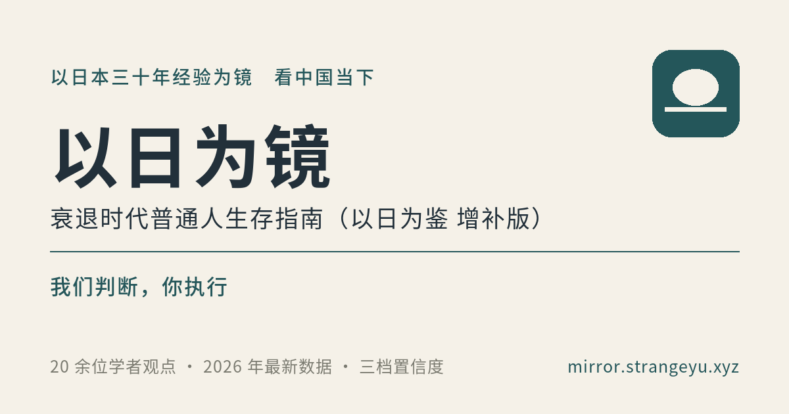

# 以日为镜

以日本 1990 年代之后的三十年经验为镜，看中国当下。 
讲日本那三十年里到底发生了什么：就业冰河期、学历贬值、考公热、教师缩编、医药寒冬、理工科劝退、全民出海。讲同样的路走到中国 2026 年，哪些正在重演、哪些不会。也讲下行期一个人该怎么算账——钱放哪、房子买不买、工作怎么选、要不要读研、要不要出海、养老和医疗这两笔躲不开的长期支出。 
七篇正文，20 余位中日及国际学者的判断逐条并排对照，85 条可查证的参考资料，每条结论标出置信度，判断不了的直接写判断不了。

Boden 的《以日为鉴：衰退时代生存指南》（开明出版社，2025 年 8 月）是叙事底稿，不是标准答案。它只有一家之言，最要紧的那步外推——日本 1994 年后的出海 → 中国 2024 年——前提没有逐条检验，数据也停在 2024–2025 年。这份增补版补的正是这一层；是独立作品，不是原书官方版本。

判断会过时，政策也各地不一样。数据优先取 2026 年，估算值写明方法来源，不同口径并排给出、不合并成一个数。发现写错了，欢迎[提 issue](https://github.com/strangeyu911-tech/mirror-guide/issues)。

### [打开在线阅读](https://mirror.strangeyu.xyz/) · [衰退时代补丁包 41 条](https://mirror.strangeyu.xyz/patch.html)

<table>
<tr><td align="right" nowrap><b>正篇</b></td><td align="left">

引子 + 七篇 + 结语：中日像不像 · 守住底线（现金、负债、资产）· 工作与职业 · 资产与房子 · 医疗与养老 · 机会在哪（出海与新产业）· 分人群行动总表

</td></tr>
<tr><td align="right" nowrap><b>补丁包</b></td><td align="left">

[衰退时代补丁包](https://mirror.strangeyu.xyz/patch.html)：正常时代的高性价比动作，进下行周期后哪 41 条要升级、反转、新增、降级

</td></tr>
<tr><td align="right" nowrap><b>离线</b></td><td align="left">

[电子书 PDF / EPUB](https://github.com/strangeyu911-tech/mirror-guide/releases/tag/ebook-2026-10)：A4 PDF（120 页，带页码、目录与书签，图表仍是矢量）+ EPUB3（22 章，可重排，适配阅读器与电子墨水屏）。封面与扉页印有作者和完整网址

</td></tr>
<tr><td align="right" nowrap><b>对照</b></td><td align="left">

20 余位中日及国际学者，逐条并排对冲：辜朝明、野口悠纪雄、吉川洋、大前研一、克鲁格曼、达利欧、珀森、林毅夫、余永定、姚洋、周其仁、陆铭、高善文、佩蒂斯、罗奇……

</td></tr>
<tr><td align="right" nowrap><b>批注</b></td><td align="left">

选中正文任意一句就能划线写批注。不用登录、不收账号，批注只有作者看得到

</td></tr>
<tr><td align="right" nowrap><b>交流</b></td><td align="left">

QQ 群 **1130141971**（去 QQ 里搜群号）· 作者微信在页面顶栏「分享」旁

</td></tr>
<tr><td align="right" nowrap><b>其他站</b></td><td align="left">

同一位作者的另一处，体裁与口径完全不同：[孙割这十年](https://strangeyu911-tech.github.io/justin-sun-corpus/)——孙宇晨 2016–17 年那 156 集音频课，与 2026 年那次 4 小时 22 分长谈并排看 · [《高性价比人生指南》衍生站索引](https://htlb.strangeyu.xyz/)

</td></tr>
<tr><td align="right" nowrap><b>许可</b></td><td align="left">

[CC BY-NC-SA 4.0](LICENSE)：可转载改编，须署名、非商用、衍生同协议开源

</td></tr>
</table>

公开信息整理与个人研究观点，不构成投资、职业、医疗或法律建议。原书内容以 Boden 原著为准。

---

## 它想回答的问题

灵感源自财经分析师 Boden 的《以日为鉴：衰退时代生存指南》（开明出版社，2025 年 8 月），是它的**独立增补作品，非原书官方版本**。原书最有价值的贡献，是把日本 1990 年代之后的职业史（就业冰河期、学历贬值、考公热、教师与医生、医药寒冬、理工科劝退、全民出海）讲成可以对照个体命运的具体经验。它只有一家之言，最要紧的那步外推（日本 1994 年后的出海 → 中国 2024 年）前提没有逐条检验，数据也停留在 2024–2025 年。

本增补版以原书 5 篇 15 章及作者 B 站书外视频为叙事底稿与覆盖清单（引自书内的标章号，引自视频的标「书外」），逐条用 **20 余位中日及国际经济学家、学者**的研究做补充与对冲，结合截至 **2026 年 10 月**的最新数据，直接给出「结论 + 置信度 + 依据 + 行动」。

相比原书，增补版新增六件事：① 20 余位学者观点逐条对冲并标注来源；② 三级置信度与证伪信号；③ 数据更新至 2026 年 10 月（估算注明方法来源）；④ 养老金个人账户空账专题、医生／教师／公务员职业分析、出海与新产业、五类人群决策树；⑤ 对「人口宿命论」「个体无力论」等过度悲观外推的修正；⑥ 85 条可核查参考资料与开源页面。

> Boden 是被审视的对象，不是裁判。他书中不严谨的外推，在多视角对照中被修正；综合各方判断后直接给结论，而不是把选择题丢给读者。

## 判断是怎么做出来的

- **作者权威化**：综合学者判断与最新数据后直接下结论、给动作，不让读者在对立观点间自行选边。
- **三级置信度**：`[高可信·已查证]` / `[推演·中可信]` / `[推演·低可信]`，每条结论标注证据强度。
- **来源可追溯**：正文以上标 `[n]` 对应文末 85 条参考资料（专著、学术论文、官方统计、权威媒体访谈）。
- **数据纪律**：优先 2026 年、至少 2025 年数据；凡学者／机构估算值均明确标注「估算（估算方法来源于 xxx）」，官方数据发布后更新；不同口径并排呈现（如养老金「基金池总量」与「个人账户结构」两套口径）。
- **风险写实**：区分事实与推演，不回避坏消息，也不给出超出证据的恐慌性结论；每个风险判断都配个人可执行的解法。

## 七篇讲什么

引子 + 七篇 + 结语 + 参考资料：

1. **第一篇** 中日对照总判断（哪些相同、哪些不同、哪些角度会重蹈覆辙）
2. **第二篇** 宏观周期与政策对冲（资产负债表衰退之争、情形 A/B 的作者结论）
3. **第三篇** 工作与职业（就业冰河世代、学历贬值、读研／读博决策、医生／教师／公务员、中年返贫；3.3 学历五笔账在目录侧栏做可折叠分组）
4. **第四篇** 资产、房子与婚姻（买房租房、**租金回报率三种口径算法与当前城市区间**、**城市分档 × 买租判定矩阵**、**提前还贷 vs 保留现金的现金流算账**、**日本「负动产」三条镜鉴**、资产配置、婚姻作为长期合伙）
5. **第五篇** 医疗与养老（医药行业、多支柱养老、**个人账户空账**专题）
6. **第六篇** 机会在哪（新产业、出海；含**普通人找外派岗的渠道清单（按可信度排序）**、**五种出海模式的风险量化**、**按能力对号的三条决策入口**与避坑清单）
7. **第七篇** 分人群落地动作总表（应届生 / 中年高房贷 / 中年低负债 / 自由职业 / 临近退休）
8. **结语** 在存量时代做跨周期玩家

## 衰退时代补丁包

`patch.html` 是致敬 GitHub 开源项目 [HowToLiveBetter《高性价比人生指南》](https://github.com/eternity4719/HowToLiveBetter)（CC BY 4.0）的独立增补作品。原指南讲的是**正常时代**怎么活（怎么不早死、不浪费钱、不踩法律红线）；补丁包不重复这些，只做一件事——当经济进入下行周期，哪些「高性价比动作」要**升级、反转、新增、降级**，共 **41 条**。每条写明成本、换回什么、证据档（高可信·已查证 / 推演·中可信 / 推演·低可信）、适用人群与触发档位，并链回正篇对应章节的完整论证。

- 在线：https://mirror.strangeyu.xyz/patch.html
- 用法：先读页首「情形 A / B」当前档位（这是随季度财政、物价、房地产数据滚动调整的活判断，以页面标注的判断时点为准）；标「两情形都做」的现在就做，标「仅 B 档加码」的等证伪信号出现再启动、信号消退即撤回。
- 宏观衰退无法做随机对照试验，证据口径沿用正篇的三级置信度，不含「做了就一定怎样」的保证。

**许可与改编声明**：原书正文以 [CC BY 4.0](https://creativecommons.org/licenses/by/4.0/) 许可发布，允许转载、改编与商用，唯须署名、附许可链接并标明改动。本补丁包是其**独立衍生增补**：未收录、未复制、也未改动原书任何一条正文；41 条补丁与「情形 A / B」判断均为 Strange 的独立作品（已按 CC BY 4.0 标明为改编），证据口径与原书不同、不代表原作者观点，原书内容以其[仓库中文原文](https://github.com/eternity4719/HowToLiveBetter)为准（参照时点 2026 年 10 月）。补丁包自身的文字与代码另以 [CC BY-NC-SA 4.0](LICENSE) 开源。补丁包为独立衍生作品，与 HowToLiveBetter 无隶属关系。

## 对照了哪些学者

- **日本本土**：辜朝明（Richard Koo）、野口悠纪雄、吉川洋、大前研一等
- **国际涉日**：保罗·克鲁格曼、瑞·达利欧、亚当·珀森（Adam Posen）等
- **中国国内**：林毅夫、余永定、姚洋、周其仁、陆铭、何帆、郑永年、温铁军、高善文、郑秉文等
- **海外中国研究**：迈克尔·佩蒂斯、斯蒂芬·罗奇、马丁·雅克、罗思义等

## 读者批注

两个页面都接了批注层：选中正文任意一句 → 划线 → 写批注。**不用登录、不收集账号**，提交的内容只有作者能看到，别人打开页面只会看到自己划过的（私有回显）。

- 前端 `annotate.js`（约 33 KB，无依赖）：高亮走 CSS Custom Highlight API，**不改动正文 DOM**，所以不影响目录、锚点跳转与 scroll spy。
- 后端 `worker/`（Cloudflare Worker + KV）：守 origin 白名单、限流、幂等去重，再用维护者凭据把批注代发到私有仓库的聚合 issue。详见 [`worker/README.md`](worker/README.md)。
- 锚点存「章节 + 章节内偏移 + 原片段 + 前后 40 字上下文」，正文改动后靠上下文匹配自愈（三级降级）。

## 读者交流

两页共享同一个入口，在顶栏「分享」键旁边（`qqgroup.js`）：

- **加 QQ 群** —— 群号 **1130141971**。一键加群链接带的是**有时效的签名参数**（`authKey` / `data`），所以页面上真正的兜底是群号本身：可选中、有一键复制按钮。微信内置浏览器会拦 QQ 域名，检测到微信环境时那一行直接换成「复制群号」，不让读者白点。
- **加作者微信交流** —— 点那一行，二维码在菜单里展开，扫码或长按识别。页脚另有一块同样的 QQ 群卡片做兜底。

二维码不是从截图里裁的：截图的模块边长是非整数（432px ÷ 37 模块 = 11.676px），按像素裁会带亚像素相位偏差、重绘后边缘发毛甚至扫不出。`tools/wechat-qr-extract.py` 改成先反推模块网格（以「OpenCV 能否解码」为验收标准）再按原图配色重绘，四周按规范补 4 模块静区，成品 720×720 / 约 4 KB。

## 技术形态

纯静态**单文件 HTML**（内联 CSS/JS，无构建、无追踪脚本），双击即可离线阅读；另有四个可选增强件：`annotate.js`（批注）、`qqgroup.js`（顶栏 QQ 群／微信下拉入口）、`wechat-qr.png`（作者微信二维码）、`og.png` / `patch-og.png`（1200×630 社交分享封面，缺失也不影响页面本身）。

可直接部署到 Cloudflare Pages / GitHub Pages / Vercel / Netlify 等任何静态托管。

## 本地使用

下载 `index.html`，用任意现代浏览器打开即可。

## 自行部署

- **Cloudflare Pages / Vercel / Netlify**：新建项目，直接上传 `index.html`。
- **GitHub Pages**：Fork 本仓库后在 Settings → Pages 选择从根目录部署。

## 许可

文本与代码采用 [知识共享 署名-非商业性使用-相同方式共享 4.0 国际许可协议（CC BY-NC-SA 4.0）](LICENSE)：可自由分享与改编，但须署名、不得用于商业用途、衍生作品须以相同协议开源。

## 免责声明

本项目为公开信息整理与个人研究观点，**不构成投资、职业、医疗或法律建议**。所有数据来自公开来源，估算与推演均已标注置信度；请结合自身情况独立决策。

## 数据更新说明

以下数据在官方发布后将更新替换：2027 年度国考公告（2026 年 10 月中旬）、2026 年秋季小学实际招生数（教育部 2027 年统计公报）、收储专项债全国官方汇总数、各城市租金回报率半年度机构口径（58 安居客 / 贝壳 / 易居 / 中指）等。

---

整理与增补：[@strangeyu911-tech](https://github.com/strangeyu911-tech) · Strange Leo &lt;strangeyu911@gmail.com&gt;
